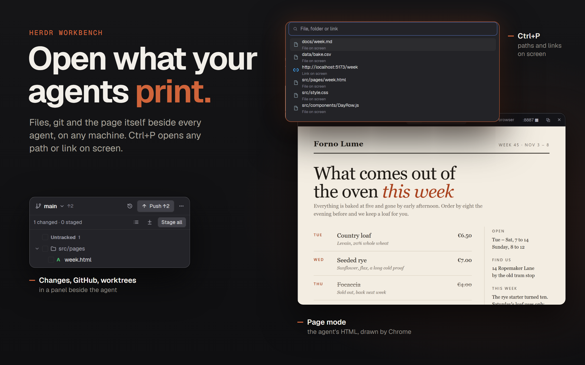

# Herdr Workbench

A workbench layout for [Herdr App](https://herdr.dev): your agents in one Inbox on the left, their terminals in the middle, and on the right a panel with files, git, GitHub, worktrees, ports and the machine they run on. Files open in floating viewers that draw Markdown, tables, pictures and whole web pages. Ctrl+P opens any path or link an agent just printed. Works on Windows, macOS and Linux, and on your other machines over ssh.

Thanks to [JinJieBeWater/herdr-t3](https://github.com/JinJieBeWater/herdr-t3), which this layout is built on, and to [alarboulletmarin/herdr-github](https://github.com/alarboulletmarin/herdr-github) for the Changes and GitHub panels.

## Features

**Sidebar**
- **Inbox**: every agent is a card in one list, newest finish first. A working agent keeps its place until it stops, then moves up. The card leads with its space's icon and name, then the branch with commits to push `↑n` and pull `↓n`, the sub-agent count, the machine and the program.
- **Sub-agents** show under their parent as a tree, open by default. A chevron folds them, and blocked ones still show while folded. Clicking one peeks at it.
- **Lists**: Spaces and Agents, one key away from Inbox. Spaces fold worktrees under their checkout and group by machine. A long space name uses the whole row.
- **Space icons**: the repo's own favicon, icon or logo, found among the files git knows about, shallowest first. To pick one yourself, add `{ "<repo folder>": "<path in the repo>" }` to `~/.config/herdr-app/t3-icons.json`. With none, a folder in the space's color.
- **New space** on any machine in any folder: pick the machine, then type or step through its folders from its home. On this computer, Browse… opens the system picker too.
- The same names and status marks everywhere: a spinner while working, `!` when blocked, a dot when done.

**Tabs and panes**
- Slim 24px tabs and framed panes with a header. Closing a tab or pane asks first while a program is running in it.
- **Actions** at the top right of the tab bar: `▶` runs the command you ran last, `▾` lists them all.
- A panel button at the end of the tab bar, or `ctrl-shift-g`, opens the right panel.

**Right panel**
- **Search**: text in every file of the focused terminal's repository, on its machine. Plain text, smart case, `.gitignore` respected, matches grouped by file. A match opens its file in the viewer. Uses `rg`, else `git grep`, else `grep`.
- **Files**: a file tree with Material icons, read ahead so folders open at once, on this computer or another machine.
  - Selection as in VS Code: click, Ctrl-click and Shift-click.
  - A right-click menu after VS Code's Explorer: new file or folder, rename, cut, copy, paste, duplicate, copy path, reveal, open in terminal, and delete to the Recycle Bin or trash. Several selected rows act together.
- **Changes**: git status, diffs, commits and history.
- **GitHub**: issues, pull requests, CI and briefs for agents. It follows the focused terminal, on other machines too.
- **Worktrees**: every checkout of the repo with changed files, its PR, the agents working in it, open as a space, and remove when merged.
- **Ports**: servers listening on the machine, grouped by the space whose folder they run in. Forward one over ssh and open it, or stop it.
- **Machine**: CPU, memory, swap, disks, NVIDIA GPUs and top processes.

**Viewer**
- A file opens in a floating window you can drag anywhere. A click reuses it, and the menu's Open in new window gives a file its own.
- Markdown with Preview and Source. Relative links open the file here and web links open the browser.
- CSV and TSV as a table.
- Pictures, from other machines too.
- Code with highlighting. Files that aren't UTF-8 are read as CP949.
- **Editing**: type in Source and save with `ctrl-s`, on this computer or another machine. A `●` after the name marks unsaved changes, and closing asks Save, Discard or Cancel.
  - A file an agent changes reloads by itself. With unsaved changes, a `⚠` shows instead: click it for Reload from disk, or `ctrl-s` to save yours over it.
  - A window with unsaved changes isn't reused: the next file opens in its own.
  - Files read as CP949 and files over 1 MB stay read only.
- **HTML pages as Chrome draws them**: the Page mode runs a headless Chrome, Edge, Chromium or Brave and shows the whole page as a picture, CSS, JavaScript and fonts included. The page is served from its folder, so `fetch()` works. Open in browser uses the same server, tunneled over ssh for another machine.

**Ctrl+P: open what an agent printed**
- A popup that lists the links and paths on the focused terminal's screen, newest first, keeping only paths that exist.
- Paths resolve against the terminal's folder and machine. A relative path that isn't there is also tried under the folders of other paths on the same screen, where agents usually work.
- Type instead: `src/main.ts:42`, `~/notes`, `/c/Users/...`, `file:///...`, `https://...`, or just `google.com` and `localhost:5173`.
- A file opens in the viewer. A link opens in the viewer's Page mode or in the browser. A folder lists what's in it, with Open a terminal here and Reveal.
- ↑/↓ to pick, Enter to open, Tab to complete, Esc to close.

## Install

Copy `layouts/`, `mods/` and `t3-common/` into `~/.config/herdr-app/`, merge `keys.json` into yours, then switch to the layout with `ctrl-shift-l` or `herdr-app do layout.switch --name herdr-t3`. Or ask your Herdr agent to add this repo.

`t3-common/` holds the code that differs by OS, shared by `t3-files`, `t3-spotlight` and `t3-new-menu`. A mod can only import its own files, so each carries a copy in `common/`. The file tree copies `t3-common/` into them when it starts, so edit `t3-common/` and never the copies. Run `node t3-common/test.mjs [machine]` to test it.

### What each OS needs

| For | Needs |
| --- | --- |
| Page mode | node 22+ and Chrome, Edge, Chromium or Brave. `CHROME_PATH` names one anywhere |
| Open in browser, Page for local files | python3, or `python` on Windows |
| Copy path on Linux | wl-copy, xclip or xsel |
| GitHub panel | `gh`, signed in |
| Trash on macOS and Linux | `trash` on macOS 15+, `gio` or `trash-put` on Linux. Without one, delete is permanent and the dialog says so |
| Hidden ssh tunnels | a key at `~/.ssh/herdr_tunnel`. Without it, ssh runs in a tab where it can ask for the password |

## Keys

| Key | Does |
| --- | --- |
| `ctrl-p` | Ctrl+P popup. It takes Ctrl+P from terminal programs; on macOS bind `cmd-p` instead |
| `ctrl-shift-n`, `cmd-shift-n` | New space: the machine, then the folder on it |
| `ctrl-shift-b`, `cmd-shift-b` | Switches the sidebar between Inbox and Lists |
| `alt-down` / `alt-up`, `cmd-]` / `cmd-[` | Next or previous agent |
| `ctrl-w`, `ctrl-shift-w`, `cmd-w` | Closes the tab, asking first if a program is running; the last tab closes its space. `ctrl-w` no longer deletes a word in the shell |
| `ctrl-shift-x`, `cmd-shift-w` | Closes the pane, asking first if a program is running |
| `ctrl-shift-g`, `cmd-shift-g` | Shows or hides the right panel |
| `ctrl-shift-f`, `cmd-shift-f` | Search in the right panel. It takes `ctrl-shift-f` from Herdr's find in the terminal, which moves to `ctrl-alt-shift-f` |
| `ctrl-s`, `cmd-s` | Saves the file in the viewer |

## What it runs

- Spaces and Inbox: read-only `git status`, `git rev-parse`, `git rev-list` and `git ls-files` in your spaces' folders, and `hc label` on agents.
- Files: `sh` here and on other machines, PowerShell on Windows. Page mode runs a headless browser with a fresh profile it deletes after. Open in browser starts `python -m http.server` bound to 127.0.0.1, and `ssh -L` for another machine.
- Ctrl+P: `hc read` of the focused terminal.
- Search: `rg`, `git grep` or `grep` in the repository, on its machine.
- Saving on another machine: `sh` there, with `mktemp`, `printf`, `base64` and `cat`.
- GitHub and Worktrees: `gh`. Ports: `ss` or `Get-NetTCPConnection`, and `ssh -L` when you forward one.
- The GitHub panel's agent briefs ask the agent to report in Korean. Change it in `mods/github/brief.js`.

## Preview picture

`sh scripts/preview/preview.sh up`, `scene`, `poster`, then `down` rebuilds `preview.png` on Windows. `scene` shoots made-up projects and stand-in agents in a Herdr window with its own core and home, and `poster` lays three pieces of those shots out with `scripts/preview/poster.html`.

## License

Apache-2.0, as herdr-t3 and Herdr App. `mods/git` and `mods/github` are MIT, see their `LICENSE`. The icons in `mods/t3-files/material` are from Material Icon Theme, MIT.
