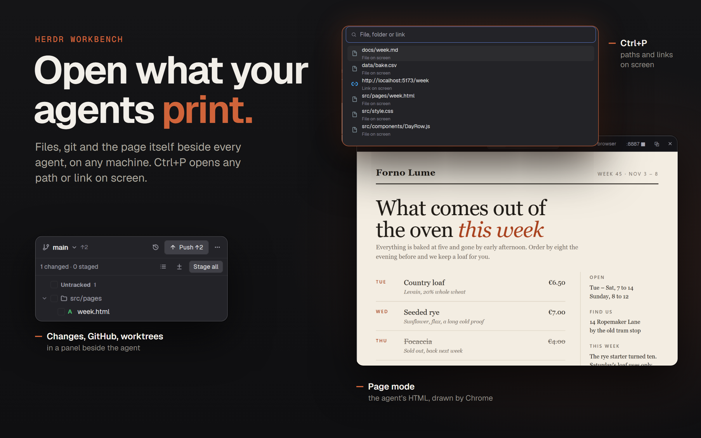

# Herdr Workbench

A workbench window for Herdr App. Agents sit in one Inbox list on the left, newest finish first, with their sub-agents as a tree. Their terminals fill the middle in framed panes under slim tabs. On the right, a panel holds files, git changes, GitHub, worktrees, ports and the machine's load. A file opens in a floating viewer that draws Markdown, tables, pictures and HTML pages as Chrome draws them. Ctrl+P opens any path or link the focused terminal shows. It runs on Windows, macOS and Linux, and reaches other machines over ssh.

## What you see

The sidebar, tabs, panes, Actions and New menu are [herdr-t3](https://github.com/JinJieBeWater/herdr-t3)'s, as [its RECIPE](https://github.com/JinJieBeWater/herdr-t3/blob/main/RECIPE.md) describes them. What differs:

- **Inbox** is one list: no Pinned, Working, Snoozed or Settled sections, no Settle, Snooze or drag.
  - A card has no title line. Its first line is the space's 18px icon and name, 14px medium: `foreground` when in view, done, blocked or hovered, else `muted`. The status mark stays at the right.
  - The second line: a fold arrow, the branch, `↑n` in `ansi2` and `↓n` in `ansi1` for commits to push and pull, the sub-agent count, then the remote mark and the program icon.
  - Under it, the card's live sub-agents as a tree, open by default.
- **Spaces** rows: no repo name in the git tail. The name takes the row, and the tail is as wide as what it shows, the branch 96px at most.
- **Space icons** with no icon found: a folder glyph in the space's color.
- **Tab bar end**: a panel button before the window buttons.
- **New menu**, New space: after the machine, a folder step on that machine. The input holds a path, its home first. Rows: `New space here` with the folder up to the last `/`, then its folders, those starting with what follows first. Footer: `Browse…` on this computer, `← Machines`.
- **Right panel** (`panel`, 380px, 280 to 900, hidden at first), beside the panes:
  - `panel-nav`, 30px: icon tabs for Files, Changes, GitHub, Worktrees, Ports and Machine.
  - Below it, the chosen one:
    - **Files**: a tree with Material Icon Theme icons, light variants on a light theme.
    - **Changes** and **GitHub**: herdr-github's `git` and `github` mods.
    - **Worktrees**: each checkout of the repo, `↑↓`, changed files, its PR, the agents in it.
    - **Ports**: listening servers by space. Ports from 32768 up are under Other.
    - **Machine**: CPU, memory, swap, disks, NVIDIA GPUs, top processes.
- **Viewer**: a floating window, 780×580, with a 28px title bar.
  - The title bar holds the file's icon and name, the mode tabs and tools: ↻, Open in browser, `:port ■` while a server runs, ⧉ copy, ×.
  - Modes:
    - Markdown: Preview, Source.
    - CSV and TSV: Table, Source.
    - HTML: Page, Source, Structure.
    - A web address: Page only.
  - Code shows in JetBrains Mono with soft wrap, so Hangul doesn't overlap.
- **Ctrl+P popup**: 640×430 at the top, 60px down.
  - A 40px input with an `accent` border.
  - Nine 38px rows: a 16px icon, the label, a dim detail line.
  - A footer with the terminal's folder, `n/N`, and `↑↓ · Enter · Tab · Esc`.

## How it behaves

- **Inbox order**: by last finish. A working agent keeps the place of its last finish, else its start, kept in `localStorage` `done-at`. It moves up when it stops. `FLAT = false` in `t3-inbox/main.js` brings herdr-t3's sections back.
- **Sub-agents**: the chevron folds them; blocked ones still show while folded. A click runs `terminal.peek`. Fold state is in `localStorage` `kids-folded`. The agents list opens sub-agents by default too.
- **Push and pull counts**: `git rev-list --left-right --count HEAD...@{upstream}` in the card's folder, re-read after 20s.
- **Space icons**: `git ls-files --cached --others --exclude-standard` for `favicon.*`, `icon.*`, `*-icon.*`, `*_icon.*`, `logo.*` in svg, png or ico.
  - Order: shallowest first, then that name order, then svg, png, ico, then the shortest name, then alphabetical.
  - `t3-icons.json` in the app folder overrides, keyed by the main checkout's folder name.
  - Looked for again every minute.
- **Files tree**:
  - Folders are read ahead one level, all in one `sh` call on another machine, so they open at once.
  - Click opens the file in the viewer. Ctrl-click, Cmd-click on macOS, adds a row; Shift-click picks a range.
  - Right-click opens a menu, another copy of the mod as a popup. Names and deletes are asked in a dialog copy.
  - Several rows' paste, duplicate and delete run in one process. The first failure stops the rest and is named.
  - Delete goes to the Recycle Bin on Windows, else `gio trash`, `trash-put` or `trash`. With none of them it deletes for good, and the dialog says so.
- **Viewer**:
  - A click reuses window key `t3-files:view`, which stays where it was dropped. The menu's Open in new window gives the file its own key.
  - In Markdown, a relative link opens that file and a web link the browser.
  - Pictures are copied into `cache/t3-files/` by content hash. From another machine they come through base64, 6 MB at most.
  - Files that aren't UTF-8 are decoded as CP949.
- **Page mode**: `shot.mjs`, run with node 22+, starts a headless browser with a fresh profile.
  - It talks to the browser over CDP, 778 CSS px wide at 2x, up to 8000px tall, and prints the size it caught.
  - The page comes from the folder's server, so `fetch()` works. Without python, `file://`.
  - The picture is static: no clicks or typing. ↻ draws it again.
- **Folder server**: `python -m http.server 0 --bind 127.0.0.1`, started as a herdr-core terminal with `hc run --bg --no-parent --rm` and label `t3-files.serve`.
  - A program `exec` starts ends with its call, so the server has to be a core terminal.
  - The port is read from its output, and the server is reused through shared `t3-files.servers`.
  - On another machine, `ssh -L` brings the same port here: hidden with `~/.ssh/herdr_tunnel`, else in a tab. The tunnel's pid is kept so stopping ends it.
- **New space folder**:
  - The machine's home comes from its `sh` (`$HOME`), else PowerShell, so the folder is a whole path there.
  - Enter on a folder or Tab goes into it; Enter on `New space here` runs `space.new {machine, folder}`.
  - Dot folders show once a `.` is typed. A folder that can't be read says why and still offers its path.
  - `Browse…` opens the system folder picker, this computer only.
  - The Inbox's and Spaces' New space buttons and `ctrl-shift-n` open it: they set shared `t3-new-menu.start` to `{ machine?, at }`, then `mod.open`, since `mod.open` takes no props. A machine's own `+` starts on its folders.
- **Ctrl+P**:
  - Empty, it lists the URLs and paths in the focused terminal's last 400 lines, newest first, paths only where they exist.
  - Trailing punctuation and a Hangul particle glued to a path are dropped.
  - A relative path not found in the terminal's folder is tried under up to 12 folders of the absolute paths on the same screen.
  - A `file://` link, typed or on screen, is the file it names, `%xx` decoded.
  - Typed text is resolved against the terminal's folder on its machine:
    - `:line` suffixes are dropped.
    - `~` is home.
    - Git Bash's `/c/` is `C:/`.
  - A folder lists its entries; Enter or Tab goes in. A missing name completes from its folder, prefix matches first.
  - `google.com` or `localhost:5173` becomes a link unless a file of that name is there. A name ending in a common file extension stays a path unless it has a `/`.
  - Enter typed before the rows caught up opens the new first row.
  - Comparisons fold case and Unicode form.

## Built from

- `layouts/herdr-t3.json`: herdr-t3's tree, with `work-body` holding `main` and `panel`. `panel` is a column of `panel-nav` (`t3-panel` `{ "view": "nav" }`) and `panel-body`, a stack of:
  - `files`: `t3-files`.
  - `changes`: `git`.
  - `github`: `github`.
  - `worktrees`, `ports`, `machine`: `t3-panel` with that `view`.
- Mods from herdr-t3: `t3-chrome`, `t3-spaces`, `t3-agents`, `t3-inbox`, `t3-tabs`, `t3-pane`, `t3-actions`.
- `git`, `github`: herdr-github's. `github` follows another machine's terminal too, opens URLs with `cmd /c start` on Windows, and its briefs ask for Korean.
- `t3-files`: a `mod.clone` of Herdr's shipped `files`, then `viewer.js`, `menu.js`, `ops.js`, `serve.js`, `page.js`, `shot.mjs` and the Material icons in `material/` with `material-map.js`.
  - Its copies are `props.viewer`, `props.menu` and `props.ask`.
- `t3-panel`: new. Ports runs `ss -Hltnp`, or `Get-NetTCPConnection` on Windows; Machine reads CIM on Windows.
- `t3-spotlight`: new, `"place": "none"`, opened by `mod.open:t3-spotlight`. It opens t3-files' viewer with `openOverlay({ mod: "t3-files", kind: "window", key: "t3-files:view", props: { viewer } })`, where `viewer` is `{ root, path, on }` or `{ url }`.
- `t3-new-menu`: herdr-t3's, with the folder step. `check-new-menu.cjs` tests it in a fake `herdr`.
- `t3-common/`: what differs by OS, copied into `mods/t3-files/common/`, `mods/t3-spotlight/common/` and `mods/t3-new-menu/common/` by `sync.mjs`.
  - `platform.js`: open, reveal and its label, copy, the python name, hidden processes, PowerShell.
  - `fsx.js`: `list`, `listMany` and `stat` on any machine.
  - `paths.js`: resolving and splitting paths.
  - `fsq.mjs`: node's view outside home on Windows.
- `keys.json`: `global` `ctrl-p`; `layout:herdr-t3` adds `ctrl-shift-g` / `cmd-shift-g` for `layout.toggle:panel` and Windows keys for herdr-t3's commands.

## Watch out

- A mod can't import another mod's files: `../t3-common/x.js` is refused as outside the mod's folder. Hence the copies. `t3-files`' tree runs `node t3-common/sync.mjs` when it starts; it writes only what differs.
- A mod's `fs` reads only under home and can't see `Program Files`.
  - `shot.mjs` finds the browser itself.
  - `fsx.js` goes through `fsq.mjs` or PowerShell on Windows, `sh` elsewhere.
- The runtime writes a `Uint8Array` as an empty file and has no `fs.stat`. Pictures go down as base64 text and `base64 -d` decodes them. macOS has `shasum` and an older `base64 -D`.
- macOS stores Hangul names decomposed. `stat` retries a miss in NFD, and names compare in NFC.
- Herdr doesn't give a mod Ctrl+click on terminal text; it goes to the system opener. Ctrl+P is the way in. See herdrdev/herdr-app#228.
- Full-screen TUIs keep no scrollback, so `hc read` sees only their screen.
- A popup is as tall as what it holds: the Ctrl+P list has a fixed height.
- Ctrl+P takes Ctrl+P from terminal programs. On macOS bind `cmd-p`.

## Done when

- `herdr-app check` passes for every mod in `mods/`, and `layout.switch {"name": "herdr-t3"}` shows the window.
- `node t3-common/test.mjs` prints `all … passed`; given a machine name, it also passes there.
- `node t3-common/sync.mjs --check` prints `all copies match`.
- `ctrl-shift-g` shows the panel. Each tab in its nav shows its view.
- Clicking a `.md` file in Files opens the viewer on Preview, and a `.html` file on Page with the page drawn.
- New space, then another machine, lists that machine's home folders; Enter on `New space here` in one opens a space there.
- `node mods/t3-new-menu/check-new-menu.cjs` prints `ok new menu`.
- In a terminal that printed a relative path, Ctrl+P lists it; Enter opens it in the viewer.
- Typing `google.com` in Ctrl+P and pressing Enter opens `https://google.com` in the viewer's Page mode.
